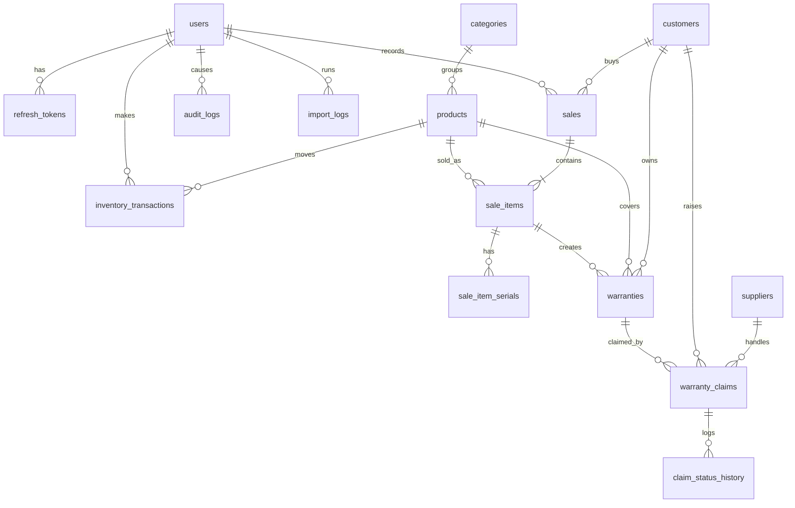

# Database Design (PostgreSQL 16)

> Based on SRS §5. Conventions: `BIGINT GENERATED ALWAYS AS IDENTITY` keys, `NUMERIC(12,2)` money, `TIMESTAMPTZ` (UTC) times, and status columns constrained with `VARCHAR` and `CHECK`. Fully implemented and verified in Knex migrations (`server/src/db/migrations/`).

---

## 1. Entity Relationships



---

## 2. Relational Schema (DDL)

The schema consists of 16 tables and 2 dedicated sequences, organized across Phase 1 (Core) and Phase 2 (Warranty & Operations).

```sql
CREATE EXTENSION IF NOT EXISTS pg_trgm;

-- =============================================================================
-- Phase 1: Core Engine Tables
-- =============================================================================

CREATE TABLE users (
  id BIGINT GENERATED ALWAYS AS IDENTITY PRIMARY KEY,
  username VARCHAR(50) NOT NULL,
  password_hash TEXT NOT NULL,
  full_name VARCHAR(100) NOT NULL,
  role VARCHAR(10) NOT NULL CHECK (role IN ('admin','staff')),
  status VARCHAR(10) NOT NULL DEFAULT 'active' CHECK (status IN ('active','inactive')),
  must_change_password BOOLEAN NOT NULL DEFAULT TRUE,
  failed_attempts INT NOT NULL DEFAULT 0,
  locked_until TIMESTAMPTZ,
  last_login_at TIMESTAMPTZ,
  created_at TIMESTAMPTZ NOT NULL DEFAULT now()
);
CREATE UNIQUE INDEX users_username_uq ON users (lower(username));

CREATE TABLE refresh_tokens (
  id BIGINT GENERATED ALWAYS AS IDENTITY PRIMARY KEY,
  user_id BIGINT NOT NULL REFERENCES users(id),
  token_hash TEXT NOT NULL UNIQUE,
  expires_at TIMESTAMPTZ NOT NULL,
  revoked_at TIMESTAMPTZ,
  created_at TIMESTAMPTZ NOT NULL DEFAULT now()
);
CREATE INDEX refresh_tokens_user_idx ON refresh_tokens (user_id);

CREATE TABLE categories (
  id BIGINT GENERATED ALWAYS AS IDENTITY PRIMARY KEY,
  name VARCHAR(100) NOT NULL,
  description VARCHAR(255),
  status VARCHAR(10) NOT NULL DEFAULT 'active' CHECK (status IN ('active','inactive'))
);
CREATE UNIQUE INDEX categories_name_uq ON categories (lower(name));

CREATE TABLE products (
  id BIGINT GENERATED ALWAYS AS IDENTITY PRIMARY KEY,
  sku VARCHAR(50) NOT NULL,
  name VARCHAR(200) NOT NULL,
  category_id BIGINT NOT NULL REFERENCES categories(id),
  unit VARCHAR(20) NOT NULL DEFAULT 'pcs',
  cost_price NUMERIC(12,2) NOT NULL DEFAULT 0 CHECK (cost_price >= 0),
  selling_price NUMERIC(12,2) NOT NULL CHECK (selling_price >= 0),
  stock_qty INT NOT NULL DEFAULT 0 CHECK (stock_qty >= 0),
  reorder_level INT NOT NULL DEFAULT 5 CHECK (reorder_level >= 0),
  warranty_months INT NOT NULL DEFAULT 0 CHECK (warranty_months BETWEEN 0 AND 120),
  tracks_serial BOOLEAN NOT NULL DEFAULT FALSE,
  status VARCHAR(10) NOT NULL DEFAULT 'active' CHECK (status IN ('active','inactive')),
  created_at TIMESTAMPTZ NOT NULL DEFAULT now(),
  updated_at TIMESTAMPTZ NOT NULL DEFAULT now()
);
CREATE UNIQUE INDEX products_sku_active_uq ON products (lower(sku)) WHERE status = 'active';
CREATE INDEX products_category_idx ON products (category_id);
CREATE INDEX products_name_trgm ON products USING gin (name gin_trgm_ops);
CREATE INDEX products_sku_trgm  ON products USING gin (sku gin_trgm_ops);

CREATE TABLE customers (
  id BIGINT GENERATED ALWAYS AS IDENTITY PRIMARY KEY,
  name VARCHAR(100) NOT NULL,
  phone VARCHAR(30),
  created_at TIMESTAMPTZ NOT NULL DEFAULT now(),
  updated_at TIMESTAMPTZ NOT NULL DEFAULT now()
);
CREATE INDEX customers_phone_idx ON customers (phone);
CREATE INDEX customers_name_trgm ON customers USING gin (name gin_trgm_ops);

CREATE SEQUENCE sale_no_seq;
CREATE TABLE sales (
  id BIGINT GENERATED ALWAYS AS IDENTITY PRIMARY KEY,
  sale_no VARCHAR(20) NOT NULL UNIQUE DEFAULT ('S-' || lpad(nextval('sale_no_seq')::text, 6, '0')),
  idempotency_key VARCHAR(64) NOT NULL UNIQUE,
  user_id BIGINT NOT NULL REFERENCES users(id),
  customer_id BIGINT REFERENCES customers(id),
  sold_at TIMESTAMPTZ NOT NULL DEFAULT now(),
  subtotal NUMERIC(12,2) NOT NULL CHECK (subtotal >= 0),
  discount_amount NUMERIC(12,2) NOT NULL DEFAULT 0,
  total NUMERIC(12,2) NOT NULL,
  payment_method VARCHAR(20) NOT NULL CHECK (payment_method IN ('cash','card','bank_transfer','other')),
  status VARCHAR(10) NOT NULL DEFAULT 'completed' CHECK (status IN ('completed','voided')),
  voided_by BIGINT REFERENCES users(id),
  voided_at TIMESTAMPTZ,
  void_reason VARCHAR(255),
  CONSTRAINT sales_discount_ck CHECK (discount_amount >= 0 AND discount_amount <= subtotal),
  CONSTRAINT sales_total_ck CHECK (total = subtotal - discount_amount),
  CONSTRAINT sales_void_ck CHECK (
    (status = 'voided' AND voided_by IS NOT NULL AND voided_at IS NOT NULL AND void_reason IS NOT NULL)
    OR (status = 'completed' AND voided_by IS NULL AND voided_at IS NULL AND void_reason IS NULL))
);
CREATE INDEX sales_sold_at_idx ON sales (sold_at);
CREATE INDEX sales_customer_idx ON sales (customer_id);

CREATE TABLE sale_items (
  id BIGINT GENERATED ALWAYS AS IDENTITY PRIMARY KEY,
  sale_id BIGINT NOT NULL REFERENCES sales(id),
  product_id BIGINT NOT NULL REFERENCES products(id),
  sku_snapshot VARCHAR(50) NOT NULL,
  name_snapshot VARCHAR(200) NOT NULL,
  quantity INT NOT NULL CHECK (quantity > 0),
  unit_price NUMERIC(12,2) NOT NULL CHECK (unit_price >= 0),
  line_total NUMERIC(12,2) NOT NULL,
  CONSTRAINT sale_items_total_ck CHECK (line_total = quantity * unit_price)
);
CREATE INDEX sale_items_sale_idx ON sale_items (sale_id);
CREATE INDEX sale_items_product_idx ON sale_items (product_id);

CREATE TABLE inventory_transactions (
  id BIGINT GENERATED ALWAYS AS IDENTITY PRIMARY KEY,
  product_id BIGINT NOT NULL REFERENCES products(id),
  type VARCHAR(15) NOT NULL CHECK (type IN ('opening','stock_in','adjustment','sale','void_reversal')),
  quantity_change INT NOT NULL CHECK (quantity_change <> 0),
  balance_after INT NOT NULL CHECK (balance_after >= 0),
  reason VARCHAR(255),
  reference_type VARCHAR(20),
  reference_id BIGINT,
  user_id BIGINT NOT NULL REFERENCES users(id),
  created_at TIMESTAMPTZ NOT NULL DEFAULT now(),
  CONSTRAINT inv_reason_ck CHECK (type <> 'adjustment' OR reason IS NOT NULL)
);
CREATE INDEX inv_tx_product_idx ON inventory_transactions (product_id, created_at);

CREATE TABLE import_logs (
  id BIGINT GENERATED ALWAYS AS IDENTITY PRIMARY KEY,
  user_id BIGINT NOT NULL REFERENCES users(id),
  filename VARCHAR(255) NOT NULL,
  file_type VARCHAR(5) NOT NULL CHECK (file_type IN ('xlsx','csv')),
  rows_total INT NOT NULL,
  rows_valid INT NOT NULL,
  rows_error INT NOT NULL,
  status VARCHAR(12) NOT NULL CHECK (status IN ('previewed','committed','cancelled','expired','failed')),
  payload JSONB,
  expires_at TIMESTAMPTZ NOT NULL,
  created_at TIMESTAMPTZ NOT NULL DEFAULT now(),
  committed_at TIMESTAMPTZ
);

CREATE TABLE audit_logs (
  id BIGINT GENERATED ALWAYS AS IDENTITY PRIMARY KEY,
  user_id BIGINT REFERENCES users(id),
  action VARCHAR(50) NOT NULL,
  entity_type VARCHAR(30),
  entity_id BIGINT,
  details JSONB,
  created_at TIMESTAMPTZ NOT NULL DEFAULT now()
);
CREATE INDEX audit_created_idx ON audit_logs (created_at);
CREATE INDEX audit_user_idx ON audit_logs (user_id);
CREATE INDEX audit_action_idx ON audit_logs (action);

CREATE TABLE settings (key VARCHAR(50) PRIMARY KEY, value JSONB NOT NULL);
INSERT INTO settings (key, value) VALUES
  ('currency_code', '"USD"'), ('currency_decimals', '2'), ('time_zone', '"UTC"');

-- =============================================================================
-- Phase 2: Warranty & Operations Tables
-- =============================================================================

CREATE TABLE sale_item_serials (
  id BIGINT GENERATED ALWAYS AS IDENTITY PRIMARY KEY,
  sale_item_id BIGINT NOT NULL REFERENCES sale_items(id),
  product_id BIGINT NOT NULL REFERENCES products(id),
  serial_no VARCHAR(100) NOT NULL,
  released_at TIMESTAMPTZ
);
CREATE UNIQUE INDEX serial_active_uq ON sale_item_serials (product_id, serial_no) WHERE released_at IS NULL;

CREATE TABLE suppliers (
  id BIGINT GENERATED ALWAYS AS IDENTITY PRIMARY KEY,
  name VARCHAR(150) NOT NULL,
  contact_person VARCHAR(100),
  phone VARCHAR(30),
  email VARCHAR(150),
  notes TEXT,
  status VARCHAR(10) NOT NULL DEFAULT 'active' CHECK (status IN ('active','inactive'))
);
CREATE UNIQUE INDEX suppliers_name_uq ON suppliers (lower(name));

CREATE TABLE warranties (
  id BIGINT GENERATED ALWAYS AS IDENTITY PRIMARY KEY,
  sale_item_id BIGINT REFERENCES sale_items(id),
  product_id BIGINT NOT NULL REFERENCES products(id),
  customer_id BIGINT REFERENCES customers(id),
  serial_no VARCHAR(100),
  start_date DATE NOT NULL,
  expiry_date DATE NOT NULL,
  source VARCHAR(10) NOT NULL CHECK (source IN ('sale','manual')),
  created_at TIMESTAMPTZ NOT NULL DEFAULT now(),
  CONSTRAINT warranties_dates_ck CHECK (expiry_date >= start_date)
);
CREATE INDEX warranties_customer_idx ON warranties (customer_id);
CREATE INDEX warranties_product_idx ON warranties (product_id);
CREATE INDEX warranties_expiry_idx ON warranties (expiry_date);

CREATE SEQUENCE claim_no_seq;
CREATE TABLE warranty_claims (
  id BIGINT GENERATED ALWAYS AS IDENTITY PRIMARY KEY,
  claim_no VARCHAR(20) NOT NULL UNIQUE DEFAULT ('C-' || lpad(nextval('claim_no_seq')::text, 6, '0')),
  warranty_id BIGINT NOT NULL REFERENCES warranties(id),
  customer_id BIGINT NOT NULL REFERENCES customers(id),
  claim_date DATE NOT NULL,
  problem VARCHAR(1000) NOT NULL,
  status VARCHAR(20) NOT NULL DEFAULT 'Submitted' CHECK (status IN
    ('Submitted','With Supplier','Returned','Ready for Customer','Completed','Rejected','Cancelled')),
  supplier_id BIGINT REFERENCES suppliers(id),
  sent_date DATE,
  expected_return_date DATE,
  actual_return_date DATE,
  collected_date DATE,
  resolution VARCHAR(15) CHECK (resolution IN ('repaired','replaced','cannot_repair','other')),
  out_of_warranty_note TEXT,
  notes TEXT,
  created_by BIGINT NOT NULL REFERENCES users(id),
  created_at TIMESTAMPTZ NOT NULL DEFAULT now(),
  updated_at TIMESTAMPTZ NOT NULL DEFAULT now(),
  CONSTRAINT claims_expected_ck CHECK (expected_return_date IS NULL OR sent_date IS NULL OR expected_return_date >= sent_date),
  CONSTRAINT claims_actual_ck   CHECK (actual_return_date   IS NULL OR sent_date IS NULL OR actual_return_date   >= sent_date)
);
CREATE INDEX claims_status_due_idx ON warranty_claims (status, expected_return_date);

CREATE TABLE claim_status_history (
  id BIGINT GENERATED ALWAYS AS IDENTITY PRIMARY KEY,
  claim_id BIGINT NOT NULL REFERENCES warranty_claims(id),
  from_status VARCHAR(20),
  to_status VARCHAR(20) NOT NULL,
  user_id BIGINT NOT NULL REFERENCES users(id),
  note VARCHAR(255),
  created_at TIMESTAMPTZ NOT NULL DEFAULT now()
);
CREATE INDEX claim_history_claim_idx ON claim_status_history (claim_id);
```

---

## 3. Database Role & Append-Only Security

To enforce cryptographic and access integrity, MicroLedger operates with two distinct database roles:

1. **Database Owner (`DATABASE_URL`)**:
   - Used exclusively for administrative operations: Knex migrations, table creation, and seed execution.
2. **Restricted Application Role (`APP_DATABASE_URL` / `app_user`)**:
   - Used by the API server at runtime.
   - `UPDATE` and `DELETE` privileges are explicitly revoked on `audit_logs` and `inventory_transactions`.
   - Sales records can only be updated to `status = 'voided'` through service-layer controls.

The role setup is automated via `server/src/db/create-app-role.js` (`npm run db:role`):

```sql
CREATE ROLE app_user LOGIN PASSWORD 'app_password_here';
GRANT CONNECT ON DATABASE microledger TO app_user;
GRANT USAGE ON SCHEMA public TO app_user;
GRANT SELECT, INSERT, UPDATE, DELETE ON ALL TABLES IN SCHEMA public TO app_user;
GRANT USAGE, SELECT ON ALL SEQUENCES IN SCHEMA public TO app_user;

-- Append-only security revocation
REVOKE UPDATE, DELETE ON audit_logs, inventory_transactions FROM app_user;

-- Ensure future tables inherit privileges
ALTER DEFAULT PRIVILEGES IN SCHEMA public GRANT SELECT, INSERT, UPDATE, DELETE ON TABLES TO app_user;
ALTER DEFAULT PRIVILEGES IN SCHEMA public GRANT USAGE, SELECT ON SEQUENCES TO app_user;
```

---

## 4. Key Performance Queries & Invariant Verifications

### 4.1 Conditional Atomic Stock Deduction
```sql
UPDATE products
SET stock_qty = stock_qty - $2, updated_at = now()
WHERE id = $1 AND status = 'active' AND stock_qty >= $2
RETURNING stock_qty, selling_price, sku, name, warranty_months;
-- 0 rows returned indicates insufficient stock or inactive product; triggers immediate rollback.
```

### 4.2 Stock Adjustment with Row Locking
```sql
SELECT stock_qty FROM products WHERE id = $1 FOR UPDATE;
-- Compute new quantity in service; if result < 0, abort with NEGATIVE_STOCK.
UPDATE products SET stock_qty = $2, updated_at = now() WHERE id = $1;
```

### 4.3 Ledger Invariant Check (Must Return 0 Discrepancy Rows)
```sql
SELECT p.id, p.sku, p.name, p.stock_qty, COALESCE(t.total, 0) AS ledger_total
FROM products p
LEFT JOIN (
  SELECT product_id, SUM(quantity_change) AS total
  FROM inventory_transactions
  GROUP BY product_id
) t ON t.product_id = p.id
WHERE p.stock_qty <> COALESCE(t.total, 0);
```

### 4.4 Store Timezone Sales Aggregation (Store Timezone `$1`)
```sql
SELECT COALESCE(SUM(total), 0) AS total_revenue, COUNT(*) AS sales_count
FROM sales
WHERE status = 'completed'
  AND (sold_at AT TIME ZONE $1)::date = (now() AT TIME ZONE $1)::date;
```

### 4.5 Low-Stock Monitoring Query
```sql
SELECT id, sku, name, stock_qty, reorder_level
FROM products
WHERE status = 'active' AND stock_qty <= reorder_level
ORDER BY stock_qty ASC;
```

### 4.6 Overdue Warranty Claims Identification
```sql
SELECT claim_no, expected_return_date,
       ((now() AT TIME ZONE $1)::date - sent_date) AS days_with_supplier,
       ((now() AT TIME ZONE $1)::date - expected_return_date) AS days_overdue
FROM warranty_claims
WHERE status = 'With Supplier'
  AND actual_return_date IS NULL
  AND expected_return_date < (now() AT TIME ZONE $1)::date;
```

---

## 5. Retention & Seeding Protocol

- **Immutable Retention**: `sales`, `sale_items`, `inventory_transactions`, `audit_logs`, and `warranty_claims` are retained indefinitely and are never deleted.
- **Temporary State Cleanup**: `refresh_tokens` are purged after expiry; spreadsheet upload payloads in `import_logs` are cleared after commit or upon 60-minute expiration.
- **Authentic PC Hardware Seeds**: Database seeds strictly model an authentic Vietnamese PC hardware store:
  - `001_initial_admin.js`: Seeds initial administrator and core settings.
  - `002_uat_catalog.js`: Populates a 500-product catalog for enterprise-scale UAT load testing.
  - `003_pc_hardware_catalog.js`: Populates authentic Intel, MSI, Corsair, WD, and Kingston hardware inventory.
- **Execution**:
  ```powershell
  # Default setup (migrations + app role + seeds)
  npm run migrate
  npm run db:role
  npm run seed

  # Dedicated hardware catalog seed
  npm run seed:pc

  # Dedicated 500-item UAT catalog seed
  npm run seed:uat
  ```
