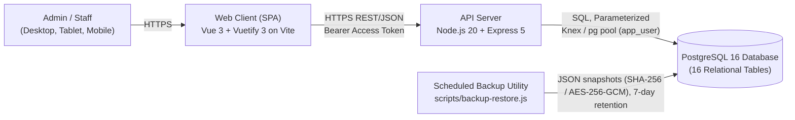
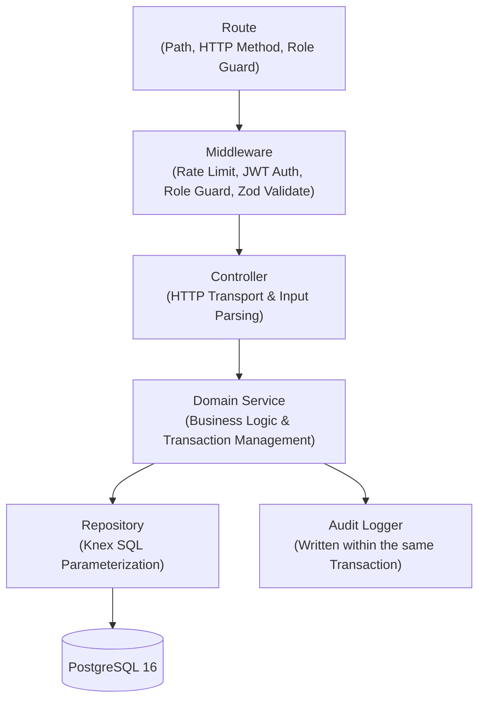
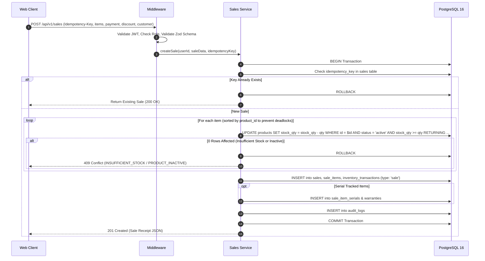
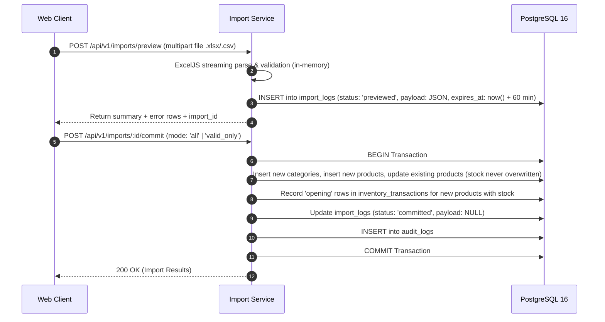
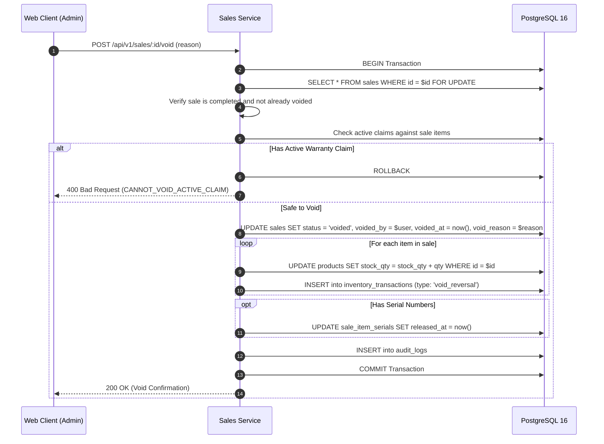

# System Architecture

> Based on BRD §8, PRD §10, and SRS §2 and §4. Database: PostgreSQL 16 (decision D-01).

## 1. Context and Components



| Component | Responsibility |
|---|---|
| **Web Client** | User interface presentation, routing, client-side input validation, responsive cart state, Vuetify 3 primitives. JWT access token held in memory only; refresh token managed via rotating `httpOnly` cookie. Enforces zero client-side business logic that the API does not independently validate. |
| **API Server** | Authentication, role authorization, Zod schema validation, transactional domain services, streaming server-side Excel/CSV parsing and generation (ExcelJS), audit log writing, and reporting. |
| **PostgreSQL 16** | Relational persistence, primary keys (`BIGINT GENERATED ALWAYS AS IDENTITY`), foreign key constraints, column CHECK constraints (`stock_qty >= 0`), trigram text search indexes (`pg_trgm`), and sequences for sale and claim numbering. |
| **Backup Utility** | Scheduled 16-table deterministic JSON snapshots with SHA-256 checksums, optional AES-256-GCM encryption, 7-day retention pruning, and isolated-schema disaster recovery restore verification drills (SRS-NFR-10). |

> [!TIP]
> **Interactive Standalone Visualizations & Deep-Dive Explainers:**
> - [**System Architecture Diagram (HTML)**](../diagrams/architecture/architecture.html) — Explorable standalone multi-tier architecture topology.
> - [**API Sequence & Message Lifecycle (HTML)**](../diagrams/sequence/sequence.html) — Animated message tracing through router, controllers, and database transactions.
> - [**Dataflow & Mutation Pipeline (HTML)**](../diagrams/dataflow/dataflow.html) — Visual pipeline of price snapshots, conditional stock deductions, and audit trails.
> - [**Interactive System & Code Explainer (HTML)**](../../MicroLedger_Explainer.html) — Self-contained oral defense walkthrough tool with live request tracer and quiz.

---

## 2. Architectural Principles

1. **Client Isolation**: The browser communicates strictly with the backend REST API over HTTPS/JSON, never connecting directly to the PostgreSQL database.
2. **Layered Separation of Concerns**: All business logic lives exclusively within Domain Services (`service.js`). Controllers handle HTTP input/output transport and Zod validation. Repositories handle parameterized SQL execution.
3. **Transactional Boundary**: Every state change affecting inventory or sales runs within a single atomic database transaction (`knex.transaction()`).
4. **Conditional Atomic Stock Updates**: Stock reduction avoids race conditions using an atomic conditional update:
   ```sql
   UPDATE products
   SET stock_qty = stock_qty - $quantity, updated_at = now()
   WHERE id = $id AND status = 'active' AND stock_qty >= $quantity
   RETURNING id, stock_qty, selling_price, sku, name, warranty_months;
   ```
   If zero rows are affected, the transaction immediately rolls back, preventing overselling.
5. **Data Types & Timezone Standards**: Monetary values are strictly stored as `NUMERIC(12,2)`. Timestamps are stored in UTC as `TIMESTAMPTZ`. The store operating timezone (`Asia/Ho_Chi_Minh` / GMT+7) is anchored at the container infrastructure level via `TZ=Asia/Ho_Chi_Minh`. Dynamic database-driven timezone reconfiguration is prohibited.
6. **Strict UI Component Primitives**: The web client strictly uses Vuetify 3 component primitives (`v-container`, `v-row`, `v-col`, `v-card`, `v-data-table` / `ResponsiveTable`, `v-btn`, `v-select`, etc.) for all layouts, grids, dialogs, and navigation. Raw HTML tables (`<table>`, `<tr>`, `<td>`) and custom scoped layout CSS hacks are banned.
7. **Ephemeral File Handling**: Uploaded spreadsheet files (`.xlsx`, `.csv`) are processed in memory streams via ExcelJS and never written to the server's local filesystem.
8. **Configuration & Secrets**: All secrets (passwords, JWT secret keys, connection strings) are loaded exclusively from environment variables and never committed to Git.
9. **Versioned Migrations**: Database schema modifications are managed via sequential Knex migrations in Git. Direct manual schema edits are prohibited.
10. **Strict Two-Role Authorization**: The system enforces two roles: **Admin** and **Staff**. Staff API responses strictly omit `cost_price`, inventory valuations, and profit calculations.
11. **Decoupled Reporting Architecture**: The system cleanly separates operational monitoring from analytical reporting:
    - **Dashboard**: Provides a static "Today / 7-Day" operational snapshot (today's totals, 7-day trend, top-selling items, inventory summary).
    - **Sales Report (`/reports/sales`)**: Handles dynamic date-range queries, multi-dimensional groupings (`day`, `product`, `category`, `user`, `payment`), and net revenue calculations.
12. **Authentic Domain Data & Test Realism**: In accordance with academic FYP requirements, all database fixtures (`003_pc_hardware_catalog.js`) strictly model an authentic Vietnamese PC hardware retail store (Intel, MSI, Corsair, WD, Kingston). Generic placeholders and Faker.js random hashes are banned.

---

## 3. API Layering



### Layer Responsibilities
- **Routes (`routes.js`)**: Declare HTTP verb, path, and allowed roles (`['admin']` or `['admin', 'staff']`).
- **Middleware (`middleware/`)**: Authenticates JWT tokens, checks user active status, checks role permissions, enforces rate limits, and validates request bodies using Zod schemas.
- **Controllers (`controller.js`)**: Extract parameters, invoke services, and serialize JSON responses (applying Staff redactions).
- **Services (`service.js`)**: Own transactional boundaries, enforce all 19 business rules, orchestrate repositories, and record audit log entries.
- **Repositories (`repository.js`)**: Execute parameterized SQL queries via Knex; never contain business validation logic.

---

## 4. Key Execution Flows

### 4.1 Complete a POS Sale



### 4.2 Spreadsheet Import with Preview



### 4.3 Void a Sale (Admin Only)



---

## 5. Security & Privilege Isolation Architecture

| Concern | Implementation Control |
|---|---|
| **Transport Security** | HTTPS strictly enforced in production; CORS whitelist restricted to frontend origin (`CORS_ORIGIN`). |
| **Password Security** | Bcrypt (cost factor 12); 8–128 character policy; account lockout after 5 consecutive failures for 15 minutes. |
| **Session Architecture** | Short-lived JWT access tokens (15-minute expiry) in memory; rotating refresh tokens in `httpOnly`, `SameSite=Lax` cookies. |
| **RBAC Authorization** | Explicit per-endpoint role verification; server-side sanitizers scrub cost prices and profit margins from Staff responses. |
| **Input Validation** | Strict Zod validation on request parameters, queries, and bodies; parameterized SQL queries only. |
| **Database Isolation** | The runtime API connects via `app_user` with `UPDATE` and `DELETE` permanently revoked on `inventory_transactions` and `audit_logs`. |
| **Formula Injection Defense** | Server-side ExcelJS exports neutralize formula triggers (`=`, `+`, `-`, `@`, `\t`, `\r`). |
| **Abuse Mitigation** | Express rate-limiting: 10 requests/min for login; 300 requests/min for general API routes. |

---

## 6. Repository Layout (As-Built)

```text
MicroLedger/
├── .github/
│   └── workflows/
│       └── ci.yml             # GitHub Actions CI pipeline (Node 20 + PostgreSQL 16)
├── client/                    # Vue 3 Frontend Single-Page Application
│   ├── src/
│   │   ├── api/               # API clients per module (auth, products, sales, etc.)
│   │   ├── components/        # Reusable Vuetify components (ResponsiveTable, dialogs, charts)
│   │   ├── router/            # Route declarations and role-based navigation guards
│   │   ├── stores/            # Pinia stores (auth, cart, notifications)
│   │   ├── utils/             # Formatters for currency, dates, and status chips
│   │   ├── views/             # 18 route views (16 authenticated panels + 2 auth views) adhering to Vuetify 3 primitives
│   │   ├── App.vue            # Root navigation shell and application frame
│   │   ├── main.js            # Frontend entry point
│   │   └── styles.css         # Baseline typographic helpers (zero scoped CSS layout hacks)
│   ├── .env.example           # Frontend environment template
│   ├── package.json           # Client dependencies (Vue 3, Vite 8, Vuetify 3, Pinia)
│   └── vite.config.js         # Vite configuration with Vuetify plugin
├── server/                    # Node.js REST API Backend
│   ├── src/
│   │   ├── config/            # Environment variable parsing and connection settings
│   │   ├── db/
│   │   │   ├── migrations/    # Versioned Knex migrations (16 relational tables)
│   │   │   ├── seeds/         # Authentic PC hardware & user seed scripts
│   │   │   ├── create-app-role.js # Restricted app_user privilege configurator
│   │   │   └── clean.js / reset.js # Database maintenance scripts
│   │   ├── middleware/        # JWT auth, role authorization, rate-limiting, error handling
│   │   ├── modules/           # Domain feature modules (auth, products, sales, inventory...)
│   │   │   └── <feature>/     # routes.js, controller.js, service.js, repository.js, schema.js
│   │   ├── utils/             # Helpers for JWT tokens, money formatting, and PII filters
│   │   ├── app.js             # Express application setup
│   │   └── index.js           # Server entry point and HTTP listener
│   ├── scripts/               # Standalone load testing and backup/restore scripts
│   ├── tests/                 # Automated test suite (integration, invariant, security)
│   ├── .env.example           # Backend environment template
│   ├── knexfile.js            # Knex connection configuration
│   └── package.json           # Server dependencies (Express 5, Knex, pg, Zod, ExcelJS)
├── docs/                      # Categorized specifications and architecture documents
│   ├── foundation/            # Charter, Problem Statement, Objectives, Scope & BSR
│   ├── requirements/          # SRS, User Stories, User Roles, Acceptance Criteria
│   ├── architecture/          # System Architecture, Database Design & Wireframes
│   ├── management/            # Roadmap, Task Backlog, DoD & Live Status Tracking
│   ├── verification/          # UAT Scripts, Realistic Hardware Fixtures & FYP Report
│   ├── guidelines/            # AI Guidelines & Agent Operating Rules
│   └── README.md              # Master documentation hub and reading guide
├── LICENSE                    # MIT License
└── README.md                  # Primary repository guide and GitHub landing page
```

---

## 7. Technology Decisions & Alternatives Comparison

### 7.1 Selection Matrix Summary

| Architectural Layer | Selected Technology | Primary Justification | Rejected Alternatives | Key Disqualification Reason |
|---|---|---|---|---|
| **Frontend Framework** | **Vue 3.5** (Composition API, `<script setup>`) | Explicit state reactivity, student-readable code structure, composable separation of concerns | React 19, Angular 18, Svelte 5 | Complex external state wiring, hook dependency pitfalls, and enterprise boilerplate obscuring academic defense |
| **UI Component System** | **Vuetify 3.13** | Standardized Material Design 3 primitives, accessible 44 px mobile touch targets, built-in responsive drawers/sheets | Tailwind CSS, Ant Design, Material UI (MUI) | Unstructured custom CSS "class soup", lack of high-level grid abstractions, poor native Vue 3 integration |
| **Client Bundler & Build** | **Vite 8** | Sub-second HMR, clean ES module compilation (700 ms production build), pure static SPA output | Next.js 14, Nuxt 3, Webpack 5 | Unnecessary Node.js SSR runtime on client, hydration mismatch risks, higher memory footprint |
| **Backend API Runtime** | **Node.js 20 LTS** + **Express 5** | Lightweight asynchronous non-blocking event loop (< 15 ms latency), transparent middleware pipeline | NestJS, Python / Django, Java / Spring Boot | Excessive enterprise decorators and heavy JVM/WSGI memory overhead violating FYP simplicity rules |
| **Schema Validation** | **Zod 4** | Declarative runtime type validation, parameter-pollution defense via `.strict()`, shared contract format | Joi, express-validator, Yup | Inferior TypeScript/JSDoc type inference, verbose imperative validation chains |
| **Relational Database** | **PostgreSQL 16** | Strict ACID transactions, atomic row-level locks (`FOR UPDATE`), disk-level `CHECK (stock_qty >= 0)`, role permissions | MongoDB 7, MySQL 8, SQLite 3 | Lack of strict relational ledger invariants, missing append-only role security, and multi-document consistency risks |
| **Query & Migration Layer**| **Knex 3** + **pg** | Programmatic transaction control, automated sequential migrations, 100% parameterized SQL injection defense | Prisma 5, TypeORM, Sequelize | Heavy ORM abstractions generating opaque queries; inability to execute fine-grained conditional atomic updates |
| **Spreadsheet Processing**| **ExcelJS 4** (Server-Streaming) | Ephemeral in-memory streaming, formula injection sanitization, zero disk bloat | PapaParse, SheetJS (xlsx) | Client tampering risks, browser tab memory exhaustion on 50,000-row files, security vulnerabilities |
| **Authentication Engine** | **Self-Managed JWT + Rotating Cookie** | LAN-operable without an external identity provider, Argon2id/bcrypt security, automatic lockout | Firebase Auth, Auth0, Supabase | Recurring vendor subscription costs and external identity-provider dependency |
| **Continuous Integration**| **GitHub Actions** | Automated end-to-end testing with containerized PostgreSQL service container on every commit/PR | Jenkins, CircleCI, GitLab CI | Complex self-hosted maintenance, external infrastructure overhead |

---

### 7.2 In-Depth Rationale vs. Alternatives

#### 1. Frontend: Vue 3 (Composition API) vs. React & Angular
- **Why Vue 3 Was Chosen**:
  Vue 3 with `<script setup>` and the Composition API provides an ideal balance of performance, developer ergonomics, and academic explainability. State reactivity (`ref`, `computed`) is declarative and granular, avoiding the complex lifecycle mental model and stale closure traps common to React Hooks (e.g., `useEffect` dependency arrays). Business logic is neatly extracted into isolated, reusable composables (`useProductsTable.js`, `useSales.js`), keeping `.vue` template containers small and strictly focused on presentation.
- **Why React Was Rejected**:
  React requires extensive external tooling (Redux Toolkit, Zustand) for state management and lacks an official, cohesive Material Design primitive library with native drawer and bottom-sheet capabilities. Furthermore, React's re-rendering nuances (memoization via `useMemo` / `useCallback`) add unnecessary complexity that distracts from core retail domain logic during an oral committee defense.
- **Why Angular Was Rejected**:
  Angular introduces heavy enterprise boilerplate—TypeScript decorators, RxJS observable streams, and dependency injection hierarchies—which over-engineers a single-store retail application and contradicts the student project's "avoid enterprise over-engineering" rule.

#### 2. UI System: Vuetify 3 vs. Tailwind CSS & Utility Libraries
- **Why Vuetify 3 Was Chosen**:
  Vuetify 3 provides a production-tested Material Design 3 component suite (`v-container`, `v-row`, `v-col`, `v-card`, `v-data-table`, `v-bottom-sheet`, `v-autocomplete`). It guarantees accessible 44 px mobile touch targets, unified typography tokens (`text-h5`, `text-body-2`, `text-overline`), and responsive layout wrappers with zero custom scoped CSS layout hacks.
- **Why Tailwind CSS Was Rejected**:
  Tailwind produces long strings of arbitrary utility classes directly in the template ("class soup"), making DOM structures difficult to read and audit. Crucially, Tailwind provides no built-in complex behavior primitives (such as mobile bottom sheets, accessible modal focus traps, or responsive table pagination), requiring developers to hand-roll custom JavaScript implementations.

#### 3. Architecture: Pure Client SPA (Vite) vs. SSR / Full-Stack Frameworks (Next.js / Nuxt)
- **Why Vite SPA Was Chosen**:
  MicroLedger is designed for single-store operations (cashier terminals, manager desks, warehouse tablets). A pure Single Page Application built by Vite compiles into static HTML/JS/CSS assets that can be served from a lightweight web server and connects to the Express API for application data. Standalone offline operation is out of scope (SRS §1.2).
- **Why Next.js / Nuxt Was Rejected**:
  Server-Side Rendering (SSR) requires a persistent rendering runtime, increasing the infrastructure footprint and introducing hydration complexity without a requirement for server-rendered pages.

#### 4. Backend: Node.js + Express 5 vs. NestJS, Python (Django), & Java (Spring Boot)
- **Why Express 5 on Node.js Was Chosen**:
  Express 5 offers a minimalist, transparent middleware pipeline (`rateLimit` ➔ `authenticate` ➔ `authorize` ➔ `validateBody` ➔ `controller` ➔ `service` ➔ `repository`). The asynchronous event loop handles concurrent POS checkouts with sub-15 ms latency while maintaining a negligible memory footprint (~60 MB RAM).
- **Why Java / Spring Boot Was Rejected**:
  Spring Boot requires heavy memory consumption (500 MB+ JVM heap), slow cold starts, and multi-layered boilerplate (DTOs, DAOs, AbstractFactories, Beans) that obscures the core business rules from academic reviewers.
- **Why Python / Django Was Rejected**:
  Django's synchronous WSGI concurrency model has lower throughput under concurrent POS checkouts. Its built-in ORM hides raw SQL transactional execution details, making it harder to prove deterministic stock ledger invariants.

#### 5. Database: PostgreSQL 16 + Knex vs. MongoDB & Heavy ORMs (Prisma / TypeORM)
- **Why PostgreSQL 16 + Knex Was Chosen**:
  PostgreSQL provides rock-solid ACID compliance, sequences for monotonic receipt numbering (`S-000001`), row-level locking (`FOR UPDATE`), and disk-level CHECK constraints (`CHECK stock_qty >= 0`) that make negative inventory mathematically impossible. Knex provides transparent query parameterization (preventing SQL injection), robust migration management, and programmatic transaction boundaries (`knex.transaction()`).
- **Why MongoDB Was Rejected**:
  NoSQL document databases lack relational integrity constraints, foreign key validation, and table-level check constraints. In a financial and inventory ledger where every movement must match the formula $\Delta S = \text{Balance}$, MongoDB creates unacceptable risks of inventory drift.
- **Why Prisma Was Rejected**:
  Prisma generates complex, automated SQL abstractions that hinder manual optimization of atomic conditional queries (`UPDATE products SET stock_qty = stock_qty - $q WHERE stock_qty >= $q RETURNING ...`).

#### 6. Spreadsheet Processing: Server-Side ExcelJS vs. Client-Side Libraries
- **Why ExcelJS Was Chosen**:
  File uploads are processed 100% on the server in streaming memory mode, validating each row against domain rules before committing. Formula injection (`=, +, -, @`) is automatically sanitized on export.
- **Why Client-Side Parsing (PapaParse) Was Rejected**:
  Client-side parsing allows users to bypass validation logic via browser dev tools and risks freezing or crashing the browser when parsing 5,000–50,000 item catalogs.

#### 7. Authentication: App-Managed JWT & Cookies vs. Cloud Identity Providers (Firebase / Auth0)
- **Why App-Managed Authentication Was Chosen**:
  The system manages its own user identities, bcrypt password hashes, and rotating refresh tokens in httpOnly cookies. This guarantees that cashier terminals and warehouse devices can authenticate locally on the local network even during external internet service interruptions, with zero recurring vendor subscription fees.

#### 8. Disaster Recovery: Application-Level JSON Snapshots vs. Raw pg_dump / Cloud Backups
- **Why Application-Level JSON Snapshots Were Chosen**:
  The backup utility (`server/scripts/backup-restore.js`) extracts all 16 tables in deterministic foreign-key topological order. It produces self-contained, human-auditable JSON snapshots protected by SHA-256 tamper-evident checksums and optional AES-256-GCM encryption (`BACKUP_ENCRYPTION_KEY`). This architecture enables true non-destructive disaster recovery drills into temporary isolated sandbox schemas without truncating or locking live store tables.
- **Why Raw Cloud / Proprietary Dumps Were Rejected as Sole DR**:
  Raw `pg_dump` binary archives require PostgreSQL superuser access, external host binaries, and full database truncation to test recovery, preventing non-destructive restore drills during live store hours.
