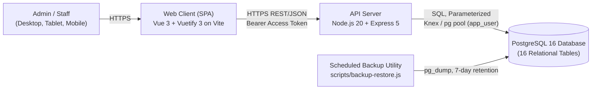
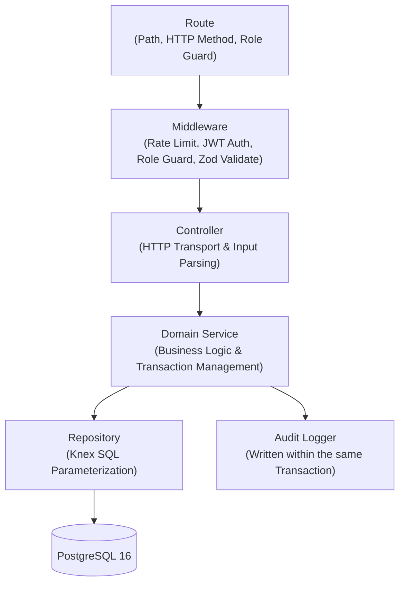
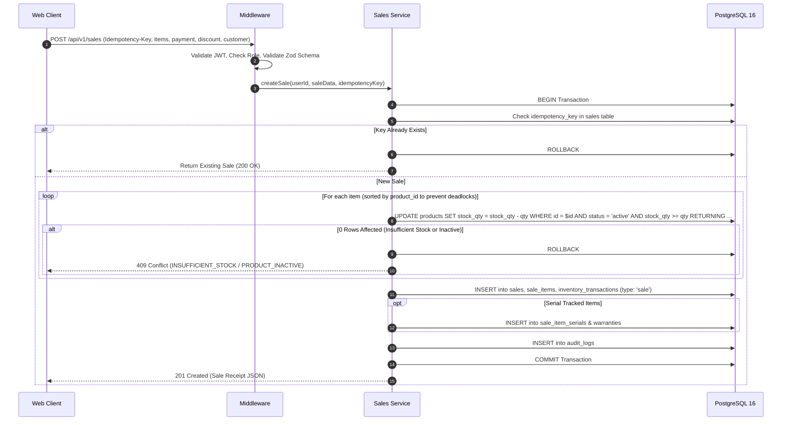
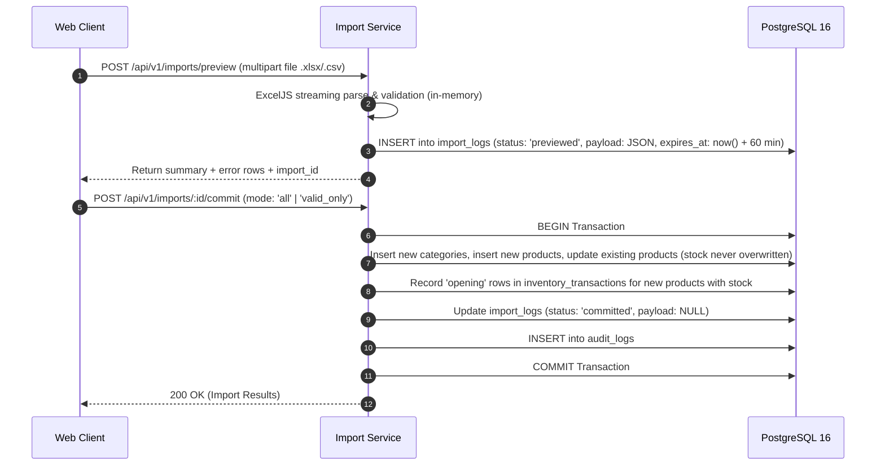
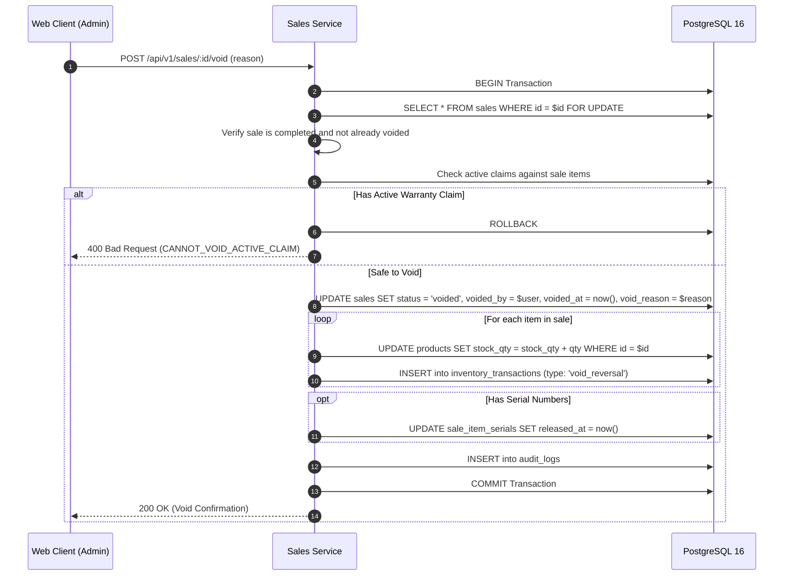

# System Architecture

> Based on BRD §8, PRD §10, and SRS §2 and §4. Database: PostgreSQL 16 (decision D-01).

## 1. Context and Components



| Component | Responsibility |
|---|---|
| **Web Client** | User interface presentation, routing, client-side input validation, responsive cart state, Vuetify 3 primitives. JWT access token held in memory only; refresh token managed via rotating `httpOnly` cookie. Enforces zero client-side business logic that the API does not independently validate. |
| **API Server** | Authentication, role authorization, Zod schema validation, transactional domain services, streaming server-side Excel/CSV parsing and generation (ExcelJS), audit log writing, and reporting. |
| **PostgreSQL 16** | Relational persistence, primary keys (`BIGINT GENERATED ALWAYS AS IDENTITY`), foreign key constraints, column CHECK constraints (`stock_qty >= 0`), trigram text search indexes (`pg_trgm`), and sequences for sale and claim numbering. |
| **Backup Utility** | Scheduled database dumps, 7-day backup retention, and disaster recovery validation drills before UAT release. |

---

## 2. Architectural Principles

1. **Client Isolation**: The browser communicates strictly with the backend REST API over HTTPS/JSON, never connecting directly to the PostgreSQL database.
2. **Layered Separation of Concerns**: All business logic lives exclusively within Domain Services (`service.js`). Controllers handle HTTP input/output transport and Zod validation. Repositories handle parameterized SQL execution.
3. **Transactional Boundary**: Every state change affecting inventory or sales runs within a single atomic database transaction (`knex.transaction()`).
4. **Conditional Atomic Stock Updates**: Stock reduction avoids race conditions using an atomic conditional update:
   ```sql
   UPDATE products
   SET stock_qty = stock_qty - $quantity, updated_at = now()
   WHERE id = $id AND status = 'active' AND stock_qty >= $quantity
   RETURNING id, stock_qty, selling_price, sku, name, warranty_months;
   ```
   If zero rows are affected, the transaction immediately rolls back, preventing overselling.
5. **Data Types & Timezone Standards**: Monetary values are strictly stored as `NUMERIC(12,2)`. Timestamps are stored in UTC as `TIMESTAMPTZ`. The store operating timezone (`Asia/Ho_Chi_Minh` / GMT+7) is anchored at the container infrastructure level via `TZ=Asia/Ho_Chi_Minh`. Dynamic database-driven timezone reconfiguration is prohibited.
6. **Strict UI Component Primitives**: The web client strictly uses Vuetify 3 component primitives (`v-container`, `v-row`, `v-col`, `v-card`, `v-data-table` / `ResponsiveTable`, `v-btn`, `v-select`, etc.) for all layouts, grids, dialogs, and navigation. Raw HTML tables (`<table>`, `<tr>`, `<td>`) and custom scoped layout CSS hacks are banned.
7. **Ephemeral File Handling**: Uploaded spreadsheet files (`.xlsx`, `.csv`) are processed in memory streams via ExcelJS and never written to the server's local filesystem.
8. **Configuration & Secrets**: All secrets (passwords, JWT secret keys, connection strings) are loaded exclusively from environment variables and never committed to Git.
9. **Versioned Migrations**: Database schema modifications are managed via sequential Knex migrations in Git. Direct manual schema edits are prohibited.
10. **Strict Two-Role Authorization**: The system enforces two roles: **Admin** and **Staff**. Staff API responses strictly omit `cost_price`, inventory valuations, and profit calculations.
11. **Decoupled Reporting Architecture**: The system cleanly separates operational monitoring from analytical reporting:
    - **Dashboard**: Provides a static "Today / 7-Day" operational snapshot (today's totals, 7-day trend, top-selling items, inventory summary).
    - **Sales Report (`/reports/sales`)**: Handles dynamic date-range queries, multi-dimensional groupings (`day`, `product`, `category`, `user`, `payment`), and net revenue calculations.
12. **Authentic Domain Data & Test Realism**: In accordance with academic FYP requirements, all database fixtures (`003_pc_hardware_catalog.js`) strictly model an authentic Vietnamese PC hardware retail store (Intel, MSI, Corsair, WD, Kingston). Generic placeholders and Faker.js random hashes are banned.

---

## 3. API Layering



### Layer Responsibilities
- **Routes (`routes.js`)**: Declare HTTP verb, path, and allowed roles (`['admin']` or `['admin', 'staff']`).
- **Middleware (`middleware/`)**: Authenticates JWT tokens, checks user active status, checks role permissions, enforces rate limits, and validates request bodies using Zod schemas.
- **Controllers (`controller.js`)**: Extract parameters, invoke services, and serialize JSON responses (applying Staff redactions).
- **Services (`service.js`)**: Own transactional boundaries, enforce all 19 business rules, orchestrate repositories, and record audit log entries.
- **Repositories (`repository.js`)**: Execute parameterized SQL queries via Knex; never contain business validation logic.

---

## 4. Key Execution Flows

### 4.1 Complete a POS Sale



### 4.2 Spreadsheet Import with Preview



### 4.3 Void a Sale (Admin Only)



---

## 5. Security & Privilege Isolation Architecture

| Concern | Implementation Control |
|---|---|
| **Transport Security** | HTTPS strictly enforced in production; CORS whitelist restricted to frontend origin (`CORS_ORIGIN`). |
| **Password Security** | Bcrypt (cost factor 12); 8–128 character policy; account lockout after 5 consecutive failures for 15 minutes. |
| **Session Architecture** | Short-lived JWT access tokens (15-minute expiry) in memory; rotating refresh tokens in `httpOnly`, `SameSite=Lax` cookies. |
| **RBAC Authorization** | Explicit per-endpoint role verification; server-side sanitizers scrub cost prices and profit margins from Staff responses. |
| **Input Validation** | Strict Zod validation on request parameters, queries, and bodies; parameterized SQL queries only. |
| **Database Isolation** | The runtime API connects via `app_user` with `UPDATE` and `DELETE` permanently revoked on `inventory_transactions` and `audit_logs`. |
| **Formula Injection Defense** | Server-side ExcelJS exports neutralize formula triggers (`=`, `+`, `-`, `@`, `\t`, `\r`). |
| **Abuse Mitigation** | Express rate-limiting: 10 requests/min for login; 300 requests/min for general API routes. |

---

## 6. Repository Layout (As-Built)

```text
MicroLedger/
├── .github/
│   └── workflows/
│       └── ci.yml             # GitHub Actions CI pipeline (Node 20 + PostgreSQL 16)
├── client/                    # Vue 3 Frontend Single-Page Application
│   ├── src/
│   │   ├── api/               # API clients per module (auth, products, sales, etc.)
│   │   ├── components/        # Reusable Vuetify components (ResponsiveTable, dialogs, charts)
│   │   ├── router/            # Route declarations and role-based navigation guards
│   │   ├── stores/            # Pinia stores (auth, cart, notifications)
│   │   ├── utils/             # Formatters for currency, dates, and status chips
│   │   ├── views/             # 18 route views (16 authenticated panels + 2 auth views) adhering to Vuetify 3 primitives
│   │   ├── App.vue            # Root navigation shell and application frame
│   │   ├── main.js            # Frontend entry point
│   │   └── styles.css         # Baseline typographic helpers (zero scoped CSS layout hacks)
│   ├── .env.example           # Frontend environment template
│   ├── package.json           # Client dependencies (Vue 3, Vite 8, Vuetify 3, Pinia)
│   └── vite.config.js         # Vite configuration with Vuetify plugin
├── server/                    # Node.js REST API Backend
│   ├── src/
│   │   ├── config/            # Environment variable parsing and connection settings
│   │   ├── db/
│   │   │   ├── migrations/    # Versioned Knex migrations (16 relational tables)
│   │   │   ├── seeds/         # Authentic PC hardware & user seed scripts
│   │   │   ├── create-app-role.js # Restricted app_user privilege configurator
│   │   │   └── clean.js / reset.js # Database maintenance scripts
│   │   ├── middleware/        # JWT auth, role authorization, rate-limiting, error handling
│   │   ├── modules/           # Domain feature modules (auth, products, sales, inventory...)
│   │   │   └── <feature>/     # routes.js, controller.js, service.js, repository.js, schema.js
│   │   ├── utils/             # Helpers for JWT tokens, money formatting, and PII filters
│   │   ├── app.js             # Express application setup
│   │   └── index.js           # Server entry point and HTTP listener
│   ├── scripts/               # Standalone load testing and backup/restore scripts
│   ├── tests/                 # Automated test suite (integration, invariant, security)
│   ├── .env.example           # Backend environment template
│   ├── knexfile.js            # Knex connection configuration
│   └── package.json           # Server dependencies (Express 5, Knex, pg, Zod, ExcelJS)
├── docs/                      # Categorized specifications and architecture documents
│   ├── foundation/            # Charter, Problem Statement, Objectives, Scope & BSR
│   ├── requirements/          # SRS, User Stories, User Roles, Acceptance Criteria
│   ├── architecture/          # System Architecture, Database Design & Wireframes
│   ├── management/            # Roadmap, Task Backlog, DoD & Live Status Tracking
│   ├── verification/          # UAT Scripts, Realistic Hardware Fixtures & FYP Report
│   ├── guidelines/            # AI Guidelines & Agent Operating Rules
│   └── README.md              # Master documentation hub and reading guide
├── LICENSE                    # MIT License
└── README.md                  # Primary repository guide and GitHub landing page
```

---

## 7. Technology Decisions Matrix

| Layer | Choice | Rationale |
|---|---|---|
| **Frontend Framework** | **Vue 3.5** (Composition API, `<script setup>`) | High performance, clear state reactivity, student-readable code structure |
| **UI Component System** | **Vuetify 3.13** | Standardized Material Design primitives, built-in accessibility, responsive drawer/sheet layouts |
| **Build Tool** | **Vite 8** | Sub-second hot module replacement and optimized production builds |
| **API Runtime** | **Node.js 20 LTS** + **Express 5** | Proven asynchronous I/O, native ES module support, broad ecosystem |
| **Input Validation** | **Zod 4** | Type-safe declarative schema validation for all incoming HTTP payloads |
| **Database** | **PostgreSQL 16** | ACID compliance, row-level locking, table CHECK constraints, trigram indexing |
| **Data Access** | **Knex 3** + **pg** | SQL parameterization preventing injection, robust migrations, programmatic transactions |
| **Spreadsheet Engine** | **ExcelJS 4** | Streaming memory processing preventing disk bloat and memory leaks |
| **Testing** | **Node.js Test Runner** + **Supertest** | Built-in test execution against a live PostgreSQL test database |
| **CI / Automation** | **GitHub Actions** | Automated build, migration, test, and load benchmark execution on push/PR |
