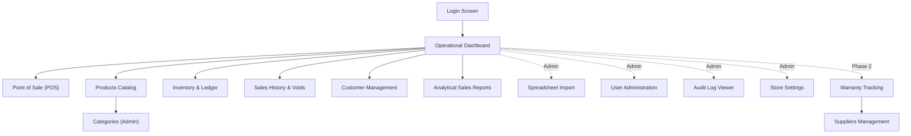

# UI/UX Design System & Wireframes

> UI/UX design specifications, typographic hierarchy, responsive breakpoints, and text wireframes for MicroLedger. Based on PRD §8 and SRS §4.1.

---

## 1. Design System & Typography Rules

### 1.1 Strict Vuetify 3 Exclusivity
- The UI is constructed strictly using **Vuetify 3 component primitives** (`v-container`, `v-row`, `v-col`, `v-card`, `v-data-table` / `ResponsiveTable`, `v-btn`, `v-select`, `v-chip`, `v-dialog`, etc.).
- **Zero Raw HTML Tables**: Standard HTML `<table>`, `<tr>`, `<td>` tags and custom CSS table hacks are banned.
- **Zero Scoped Layout CSS Hacks**: Do not introduce ad-hoc CSS grids, fixed pixel layouts, or negative margin compensations.

### 1.2 Unified Vertical Alignment & Global Wrapper
- To eliminate page jumps during navigation, all 16 authenticated application panels wrap their content inside an identical top-level container:
  ```html
  <v-container fluid class="pa-4 pa-md-6">
  ```
- All page headers follow a unified layout:
  - Container: `.page-heading` with `d-flex align-center justify-space-between flex-wrap mb-4`
  - Eyebrow: `.eyebrow text-overline text-medium-emphasis`
  - Title: `text-h5 font-weight-bold`
  - Action buttons: Primary `<v-btn color="primary">` and secondary `<v-btn variant="outlined">`

### 1.3 Universal Typography Scale
To guarantee 1:1 visual parity across all panels, the application adheres strictly to this Vuetify typography mapping:

| UI Element | Vuetify Class | Purpose |
|---|---|---|
| **Page Titles** | `text-h5 font-weight-bold` | Primary screen title (e.g., "Products", "Sales Report", "POS") |
| **Card Headers & Modals** | `text-h6 font-weight-bold` | Summary card titles, modal headers, section groups |
| **Table Headers & Eyebrows** | `text-overline font-weight-bold` | Column labels, metadata eyebrows, uppercase indicators |
| **Standard Data & Body Text** | `text-body-2` | Table cell contents, list items, description text |
| **Helper Text & Validation** | `text-caption` | Form input error hints, timestamps, status subtext |

### 1.4 Responsive Breakpoints & Accessibility
- **Breakpoints**:
  - **Mobile (< 600 px)**: Single column layouts, collapsible cards instead of wide tables, mobile cart bottom sheet, full-width action buttons.
  - **Tablet (600–1024 px)**: Flexible grid columns (`cols="12" sm="6"`), responsive table viewports.
  - **Desktop (> 1024 px)**: Multi-column layouts, 8:4 desktop POS split with independent scrolling panels.
- **Touch Ergonomics**: All interactive buttons, chips, and table icons have a minimum touch target of $44 \times 44\text{ px}$.
- **Accessibility & Contrast**: Text contrast ratios meet WCAG AA standards ($\ge 4.5:1$). Errors are conveyed via clear descriptive text rather than color alone.

---

## 2. Brand Identity & Strict Color System

### 2.1 Brand Personality & Design Philosophy
MicroLedger adopts a clean, high-density, modern FinTech & Enterprise ERP aesthetic. The interface is optimized for speed, clarity, and prolonged use under point-of-sale lighting:
- **Visual Tone**: Professional, dependable, crisp, and high-contrast.
- **Color Philosophy**: A dominant royal navy anchor balanced by glacier-tinted neutral surfaces, high-contrast dark navy typography, and muted status accents (teal, amber, crimson) to prevent visual fatigue while keeping critical warnings prominent.
- **Font Stack**:
  - **Body & Data**: `'DM Sans', -apple-system, BlinkMacSystemFont, sans-serif` (clean, highly legible geometric sans for rapid scanning of tabular data and barcodes).
  - **Brand & Headings**: `'Manrope', sans-serif` (modern, authoritative display font used for page titles, modal headers, brand marks, and store avatars).

### 2.2 Core Vuetify Theme Palette
Defined centrally in [`client/src/main.js`](file:///c:/StudyAlot/WORKFOLDER/FYP/MicroLedger/client/src/main.js), the Vuetify 3 theme establishes the immutable base tokens used throughout all UI components:

| Token Name | Hex Code | RGB | Role & Application | Contrast on Light Surface |
|---|---|---|---|---|
| **`primary`** | `#253d90` | `rgb(37, 61, 144)` | Deep Royal Navy. Primary brand anchor, primary buttons, active navigation states, key metric highlights. | $\approx 9.8:1$ (WCAG AAA) |
| **`secondary`** | `#64748b` | `rgb(100, 116, 139)` | Slate Gray. Secondary actions, neutral metadata tags, unselected controls. | $\approx 4.6:1$ (WCAG AA) |
| **`success`** | `#17866d` | `rgb(23, 134, 109)` | Emerald Teal. Positive cash flow, completed sales, in-stock badges, active user/product status. | $\approx 4.8:1$ (WCAG AA) |
| **`warning`** | `#c4832d` | `rgb(196, 131, 45)` | Amber Ochre. Low stock alerts ($\le \text{reorder}$), warranty claims with supplier, pending returns. | $\approx 3.2:1$ (Large text / Chip) |
| **`error`** | `#c64c4c` | `rgb(198, 76, 76)` | Crimson Red. Voided transactions, out-of-stock items ($0\text{ pcs}$), overdue claims, destructive actions. | $\approx 4.7:1$ (WCAG AA) |
| **`background`** | `#f5f7fb` | `rgb(245, 247, 251)` | Glacier Canvas. Off-white soft cool-gray canvas reducing eye strain under store lighting. | Canvas Base |
| **`surface`** | `#ffffff` | `rgb(255, 255, 255)` | Pure White. Card containers, data tables, dialog modals, application drawer. | Surface Layer |

### 2.3 Neutral Canvas, Surface Hierarchy & Borders
The system enforces strict surface separation through subtle tone shifts and borders rather than heavy drop shadows:

| Surface Layer | Hex / CSS Value | Location / Usage | Visual Purpose |
|---|---|---|---|
| **Global Canvas** | `#f5f7fb` | `body`, `.v-application`, `.app-main` | Unified base layer across all viewports. |
| **Card & Container Surface** | `#ffffff` | `.v-card`, `.summary-card`, `.auth-card`, `.app-drawer` | Elevated content planes for tables and forms. |
| **Table Header Surface** | `#fafbfc` | `.v-data-table th` | Subtle top boundary for data grids; separates column headers from rows. |
| **Subtle Inset / Switcher** | `#f8f9fc` | `.store-switcher` | Micro-container grouping store name and status. |
| **Active Selection Tint** | `#eff2fc` | `.nav-list .v-list-item--active`, `.v-list-item--active` | Soft royal tint confirming user selection without jarring contrast. |
| **Card & Container Border** | `1px solid #d4dce8` | `.v-card`, form inputs | Crisp border definition ensuring crisp separation on `#f5f7fb`. |
| **Divider & Shell Border** | `1px solid #edf0f5` | `.app-drawer`, `.topbar`, `.help-card` | Low-contrast structural boundaries for fixed app chrome. |
| **Table Row Border** | `1px solid #f0f2f6` | `.v-data-table td`, `.table-toolbar` | Clean row dividers preventing dense data bleeding. |

### 2.4 Typography Color Hierarchy & Contrast Ratios
To maintain visual clarity, text colors are stratified into four distinct contrast levels:

| Tier | Hex Code | Vuetify / CSS Class | Intended Use & Contrast Ratio |
|---|---|---|---|
| **Tier 1: Primary Navy-Charcoal** | `#202a3d` | `h1`, `.brand-name`, `.dialog-title`, default text | Primary headers, modal titles, high-priority numbers. ($12.8:1$ on `#ffffff`, WCAG AAA) |
| **Tier 2: Body & Form Data** | `#354157` / `#3e4b61` | `.v-data-table td`, `.v-field__input`, `.table-toolbar h2` | Table cell text, active input text, category headers. ($8.5:1$ on `#ffffff`, WCAG AAA) |
| **Tier 3: Muted Metadata & Labels** | `#7c889b` / `#8792a5` | `.eyebrow`, `.text-overline`, `th`, `.table-toolbar p` | Column headers, category eyebrows, helper subtitles. ($4.6:1$ on `#ffffff`, WCAG AA) |
| **Tier 4: Disabled & Captions** | `#9aa3b4` / `#a0a9b8` | `.text-caption`, `.nav-label`, placeholders | Input placeholders, navigation section labels, timestamps. ($3.2:1$, decorative/subtext) |

### 2.5 Semantic Status & Chip Color Matrix
All status indicators across panels use Vuetify's `v-chip` with `variant="tonal"` to render soft pastel backgrounds with high-contrast text:

| Domain | Value / State | Vuetify Color | Chip Appearance | UI Component Location |
|---|---|---|---|---|
| **Product / Category** | Active | `success` | Emerald text on pale teal | `ProductCatalogSection.vue`, `CategoryManagementSection.vue` |
| **Product / Category** | Inactive | `error` | Crimson text on pale red | `ProductCatalogSection.vue`, `CategoryManagementSection.vue` |
| **Stock Level** | In Stock ($> \text{reorder}$) | `success` | Emerald text on pale teal | `InventoryStockSection.vue`, `PosProductCatalog.vue` |
| **Stock Level** | Low Stock ($\le \text{reorder}$) | `warning` | Amber text on pale amber | `InventoryStockSection.vue`, `PosProductCatalog.vue` |
| **Stock Level** | Out of Stock ($0\text{ pcs}$) | `error` | Crimson text on pale red | `PosProductCatalog.vue` |
| **Sales Lifecycle** | Completed | `success` | Emerald text on pale teal | `SalesRegisterCard.vue`, `SaleDetailDialog.vue` |
| **Sales Lifecycle** | Voided | `error` | Crimson text on pale red | `SalesRegisterCard.vue`, `SaleDetailDialog.vue` |
| **User Role** | Admin | `primary` | Royal navy on soft blue | `UserManagementSection.vue` |
| **User Role** | Staff | `default` | Slate gray on neutral | `UserManagementSection.vue` |
| **User Status** | Active | `success` | Emerald text on pale teal | `UserManagementSection.vue` |
| **User Status** | Inactive | `error` | Crimson text on pale red | `UserManagementSection.vue` |
| **Warranty Claim** | Overdue | `error` | Crimson text on pale red | `ClaimRegisterSection.vue` |
| **Warranty Claim** | With Supplier | `warning` | Amber text on pale amber | `ClaimRegisterSection.vue` |
| **Entity Counters** | Total Counts (Pills) | `primary` | Royal navy on soft blue | Header counter chips (Claims, Events, Records) |

### 2.6 Pastel Metric Icon Tokens (Summary Cards)
Metric cards (`.summary-card`) use standardized $36 \times 36\text{ px}$ pastel rounded-square icon containers:

| Token Class | Background Hex | Icon / Text Hex | Typical Metric Usage |
|---|---|---|---|
| `.icon-blue` | `#edf1ff` | `#5a70ba` | Gross Revenue, Today's Sales, POS Transaction Volume |
| `.icon-green` | `#e9f7f1` | `#319276` | Total Profit, Completed Invoices, Restocked Units |
| `.icon-amber` | `#fdf5e8` | `#c08532` | Low Stock Items, Active RMA Claims, Pending Voids |
| `.icon-purple` | `#f2eefa` | `#7a5bb8` | Unique Customers, VIP Accounts, Store Credit |
| `.icon-rose` | `#fceeee` | `#bb7070` | Out of Stock Items, Overdue Claims, Voided Revenue |

### 2.7 Interactive States & Elevation Standards
- **Buttons (`.v-btn`)**:
  - Primary button: Background `#253d90`, text `#ffffff`. Minimum height $44\text{ px}$.
  - Outlined button: Border `1px solid #d4dce8`, text `#354157`, hover background `#f5f7fb`.
  - Icon action buttons (`.v-btn--icon`): Fixed $44 \times 44\text{ px}$ touch target for touch screens and mobile tablets.
- **Card Elevation**:
  - Default card: `box-shadow: 0 1px 3px rgba(32, 42, 61, 0.05); border: 1px solid #d4dce8;`
  - POS interactive product card hover: `border-color: #8b9bb8; background: #fbfcff;`
  - POS product card focus-visible: `border-color: #5369ae;`
  - Dialog modal shadow: `box-shadow: 0 20px 65px rgba(32, 50, 97, 0.09); border: 1px solid #edf0f5;`
  - Dropdown menu shadow: `box-shadow: 0 4px 16px rgba(25, 42, 78, 0.1);`

---

## 3. Navigation Architecture



### Role-Based Navigation Matrix
- **Staff Access**: Dashboard, POS Terminal, Products (view-only; cost prices redacted), Inventory (movement history & stock-in), Sales History, Customers, Warranty Claims.
- **Admin Access**: All Staff capabilities, plus Categories, Product Creation/Editing, Stock Adjustments, Sale Voiding, Spreadsheet Bulk Import/Export, User Administration, Audit Logs, Store Settings, and Supplier Directory.

---

## 4. Screen Wireframes

### 4.1 Authentication & Login
```text
+-------------------------------------------------------------+
|                         MicroLedger                         |
|      Point of Sale, Inventory Ledger & Warranty System      |
|                                                             |
|   Username      [ admin                                  ]  |
|   Password      [ •••••••••••••                          ]  |
|                                                             |
|   ( ! ) Invalid username or password (3 attempts remaining) |
|                                                             |
|                     [   Sign In   ]                         |
+-------------------------------------------------------------+
```
*Behavior: Automatically enforces 15-minute account lockout after 5 consecutive failed attempts.*

---

### 4.2 Operational Dashboard (Desktop)
```text
+---------------------------------------------------------------------------------------------------+
| DASHBOARD                                                                                         |
| Operational performance snapshot for today and the past 7 days                                   |
+---------------------------------------------------------------------------------------------------+
|  [ Today Sales ]       |  [ Transactions ]    |  [ Low Stock Alerts ]    |  [ Total Inventory ]*  |
|  18,450,000 VND        |  24 Completed        |  5 Items Low             |  142,800,000 VND       |
+---------------------------------------------------------------------------------------------------+
|  7-Day Sales Trend (Dynamic Bar Chart)           |  Top 5 Fast-Moving Hardware (7 Days)           |
|  [||||   ||||||   ||||   ||||||||   |||||]       |  1. Kingston NV2 500GB PCIe 4.0 SSD     (42)   |
|                                                  |  2. Corsair Vengeance LPX 16GB DDR4     (35)   |
|                                                  |  3. Intel Core i5-12400F Processor      (19)   |
+---------------------------------------------------------------------------------------------------+
* Total Inventory valuation metric is restricted to Admin role and redacted for Staff.
```

---

### 4.3 Point of Sale Terminal (8:4 Desktop Split)
```text
+---------------------------------------------------+-----------------------------------------------+
| CATALOG (Cols: 8, Independent Scroll)             | CHECKOUT (Cols: 4, Independent Scroll)        |
| Search: [ Intel Core / Kingston / SKU__________ ] | Current Sale (3 items)                        |
| Category: [ All ] [ CPU ] [ GPU ] [ RAM ] [ SSD ] |-----------------------------------------------|
|---------------------------------------------------| 1. Intel Core i5-12400F            [-] 1 [+]  |
| [CPU] Intel Core i5-12400F                        |    Serial: SN-INT-12400-0819          3,250,000|
| Price: 3,250,000 VND   Stock: 14 [ Add to Cart ]  | 2. Kingston NV2 1TB PCIe 4.0 SSD   [-] 2 [+]  |
|                                                   |    Qty: 2 x 1,450,000                 2,900,000|
| [RAM] Corsair Vengeance 16GB DDR4                 |-----------------------------------------------|
| Price: 950,000 VND     Stock: 3 (Low) [ Add ]     | Customer: [ Nguyen Van A (0901234567)      v] |
|                                                   | Discount: [ 150,000                         ] |
| [GPU] MSI RTX 4060 Ventus 2X                      | Payment:  (*) Cash  ( ) Card  ( ) Bank        |
| Price: 8,100,000 VND   Stock: 0 [ Out of Stock ]  |-----------------------------------------------|
|                                                   | Subtotal:                         6,150,000   |
|                                                   | Discount:                          -150,000   |
|                                                   | Total Due:                        6,000,000   |
|                                                   | [        COMPLETE SALE (F9)        ]          |
+---------------------------------------------------+-----------------------------------------------+
```

---

### 4.4 Point of Sale (Mobile 360 px Viewport)
```text
+-------------------------------------------+
| ☰ MicroLedger POS                Cart (3) |
+-------------------------------------------+
| [ Search SKU / Product name...          ] |
| Category: [ All ] [ CPU ] [ RAM ] [ SSD ] |
|-------------------------------------------|
| Intel Core i5-12400F                      |
| 3,250,000 VND · In Stock: 14 pcs          |
| [ + Add to Cart ]                         |
|-------------------------------------------|
| MSI RTX 4060 Ventus 2X                    |
| 8,100,000 VND · Out of Stock              |
| [ Unavailable ]                           |
+===========================================+
| Cart Bottom Sheet (Tap to expand)         |
| 3 Items · Total: 6,000,000 VND            |
| [ Review Order & Checkout ]               |
+-------------------------------------------+
```

---

### 4.5 Inventory Movement History & Invariant Ledger
```text
+---------------------------------------------------------------------------------------------------+
| INVENTORY LEDGER                                                                                  |
| Product: Intel Core i5-12400F (SKU: CPU-INT-12400F) · Physical Stock: 14                          |
| [ + Stock-In ]  [ Adjust Balance (Admin) ]                                                        |
+---------------------------------------------------------------------------------------------------+
| Filters: Movement Type [ All v ]   Date Range [ 2026-10-01 ] to [ 2026-10-22 ]                    |
+-------------------+---------------+----------+---------------+--------------+---------------------+
| Timestamp (GMT+7) | Type          | Quantity | Stock Balance | Handled By   | Reference / Reason  |
+-------------------+---------------+----------+---------------+--------------+---------------------+
| 22 Oct 14:15      | sale          | -1       | 14            | cashier1     | S-000189            |
| 20 Oct 09:30      | stock_in      | +10      | 15            | stock_mgr    | PO-2026-10-004      |
| 18 Oct 16:45      | adjustment    | -1       | 5             | admin        | Bent socket pins    |
| 12 Oct 08:00      | opening       | +6       | 6             | admin        | Initial seed        |
+-------------------+---------------+----------+---------------+--------------+---------------------+
* Invariant Check: SUM(quantity_change) == 14 (Physical Stock on Hand). Zero discrepancies.
```

---

### 4.6 Spreadsheet Import with Live Preview
```text
+---------------------------------------------------------------------------------------------------+
| BULK PRODUCT IMPORT                                                                               |
| Step 1: Download Template [ Excel .xlsx ] [ CSV ]                                                 |
| Step 2: Upload File       [ browse: hardware_import_oct.xlsx ] (Max: 5 MB / 5,000 rows)           |
+---------------------------------------------------------------------------------------------------+
| PREVIEW RESULTS: 500 Rows Total · 485 Valid · 15 Errors · 2 Warnings                             |
+-----+----------+-----------+----------------------------------------------------------------------+
| Row | Column   | Status    | Error Details                                                        |
+-----+----------+-----------+----------------------------------------------------------------------+
| 14  | Price    | [Error]   | Invalid currency format; expected numeric value, received 'N/A'     |
| 52  | SKU      | [Error]   | Duplicate SKU 'RAM-COR-16G' already assigned in row 12               |
| 98  | Category | [Warning] | New category 'Cooling' will be automatically created on commit       |
+-----+----------+-----------+----------------------------------------------------------------------+
| Commit Mode:  ( ) All Rows (Disabled: resolve errors first)                                       |
|               (*) Valid Rows Only (Imports 485 rows; skips 15 errors)                             |
|                                                                                                   |
| [ Download Error Report (.csv) ]                 [ CANCEL ]   [ COMMIT IMPORT (485 ITEMS) ]       |
+---------------------------------------------------------------------------------------------------+
```

---

### 4.7 Warranty Claims Lifecycle (7-Stage State Machine)
```text
+---------------------------------------------------------------------------------------------------+
| WARRANTY CLAIM DETAIL: C-000042                                                                   |
| Customer: Tran Minh Tuan (0918234567) · Product: MSI RTX 4060 Ventus 2X (SN: SN-MSI-4060-0412)     |
| Warranty Active: Expires 15 May 2027 · Original Sale: S-000115 (Sold: 15 May 2024)                 |
+---------------------------------------------------------------------------------------------------+
| Current Lifecycle Status: [ WITH SUPPLIER ]                                                      |
| Supplier: MSI Vietnam Service Center · Sent: 10 Oct 2026 · Expected Return: 18 Oct 2026           |
| Overdue Status: [ 4 DAYS OVERDUE ] (Calculated dynamically relative to container GMT+7 time)      |
+---------------------------------------------------------------------------------------------------+
| State Machine Transitions:                                                                        |
| [ Transition to 'Returned' ]    [ Transition to 'Cancelled' (Admin) ]                             |
+---------------------------------------------------------------------------------------------------+
| Status Audit History:                                                                             |
| 1. Submitted        (10 Oct 09:15 by cashier1) - Customer reported artifacting on DisplayPort 1  |
| 2. With Supplier    (10 Oct 14:00 by stock_mgr) - Dispatched via Express Courier RMA #99102       |
+---------------------------------------------------------------------------------------------------+
```

---

## 5. UI Component Library

All views leverage standard, encapsulated components located in `client/src/components/`:

- **`ResponsiveTable.vue`**: Universal data table wrapper that renders desktop tables with sortable columns and switches to mobile card representations below 600 px using pure Vuetify 3 primitives (`v-card`, `v-row`, `v-col`), with flat outlines and 44 px touch targets.
- **`SummaryCard.vue`**: Metric display card featuring clean Vuetify avatars, formatted numeric values, and operational trend indicators adhering to the flat achromatic ledger palette.
- **`BarcodeScannerModal.vue`**: Quick SKU/barcode modal input with immediate catalog debounce querying.
- **`ReceiptDialog.vue`**: Formatted printable receipt dialog with print CSS styles.
- **`ConfirmDialog.vue`**: Modal for destructive actions (sale void, user deactivation, stock adjustment).

---

## 6. Interactive Process & Workflow Visualizations

To explore user interactions and view transitions interactively:
- [**Workflow & User Interaction Flow (HTML)**](../diagrams/workflow/workflow.html) — Interactive standalone visualizer of POS checkout, inventory movements, and warranty claim lifecycles.
- [**Interactive System & Code Explainer (HTML)**](../../MicroLedger_Explainer.html) — Step-by-step user journey animation and request tracing.
