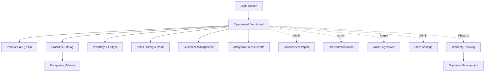

# UI/UX Design System & Wireframes

> UI/UX design specifications, typographic hierarchy, responsive breakpoints, and text wireframes for MicroLedger. Based on PRD §8 and SRS §4.1.

---

## 1. Design System & Typography Rules

### 1.1 Strict Vuetify 3 Exclusivity
- The UI is constructed strictly using **Vuetify 3 component primitives** (`v-container`, `v-row`, `v-col`, `v-card`, `v-data-table` / `ResponsiveTable`, `v-btn`, `v-select`, `v-chip`, `v-dialog`, etc.).
- **Zero Raw HTML Tables**: Standard HTML `<table>`, `<tr>`, `<td>` tags and custom CSS table hacks are banned.
- **Zero Scoped Layout CSS Hacks**: Do not introduce ad-hoc CSS grids, fixed pixel layouts, or negative margin compensations.

### 1.2 Unified Vertical Alignment & Global Wrapper
- To eliminate page jumps during navigation, all 16 authenticated application panels wrap their content inside an identical top-level container:
  ```html
  <v-container fluid class="pa-4 pa-md-6">
  ```
- All page headers follow a unified layout:
  - Container: `.page-heading` with `d-flex align-center justify-space-between flex-wrap mb-4`
  - Eyebrow: `.eyebrow text-overline text-medium-emphasis`
  - Title: `text-h5 font-weight-bold`
  - Action buttons: Primary `<v-btn color="primary">` and secondary `<v-btn variant="outlined">`

### 1.3 Universal Typography Scale
To guarantee 1:1 visual parity across all panels, the application adheres strictly to this Vuetify typography mapping:

| UI Element | Vuetify Class | Purpose |
|---|---|---|
| **Page Titles** | `text-h5 font-weight-bold` | Primary screen title (e.g., "Products", "Sales Report", "POS") |
| **Card Headers & Modals** | `text-h6 font-weight-bold` | Summary card titles, modal headers, section groups |
| **Table Headers & Eyebrows** | `text-overline font-weight-bold` | Column labels, metadata eyebrows, uppercase indicators |
| **Standard Data & Body Text** | `text-body-2` | Table cell contents, list items, description text |
| **Helper Text & Validation** | `text-caption` | Form input error hints, timestamps, status subtext |

### 1.4 Responsive Breakpoints & Accessibility
- **Breakpoints**:
  - **Mobile (< 600 px)**: Single column layouts, collapsible cards instead of wide tables, mobile cart bottom sheet, full-width action buttons.
  - **Tablet (600–1024 px)**: Flexible grid columns (`cols="12" sm="6"`), responsive table viewports.
  - **Desktop (> 1024 px)**: Multi-column layouts, 8:4 desktop POS split with independent scrolling panels.
- **Touch Ergonomics**: All interactive buttons, chips, and table icons have a minimum touch target of $44 \times 44\text{ px}$.
- **Accessibility & Contrast**: Text contrast ratios meet WCAG AA standards ($\ge 4.5:1$). Errors are conveyed via clear descriptive text rather than color alone.

---

## 2. Navigation Architecture



### Role-Based Navigation Matrix
- **Staff Access**: Dashboard, POS Terminal, Products (view-only; cost prices redacted), Inventory (movement history & stock-in), Sales History, Customers, Warranty Claims.
- **Admin Access**: All Staff capabilities, plus Categories, Product Creation/Editing, Stock Adjustments, Sale Voiding, Spreadsheet Bulk Import/Export, User Administration, Audit Logs, Store Settings, and Supplier Directory.

---

## 3. Screen Wireframes

### 3.1 Authentication & Login
```text
+-------------------------------------------------------------+
|                         MicroLedger                         |
|      Point of Sale, Inventory Ledger & Warranty System      |
|                                                             |
|   Username      [ admin                                  ]  |
|   Password      [ •••••••••••••                          ]  |
|                                                             |
|   ( ! ) Invalid username or password (3 attempts remaining) |
|                                                             |
|                     [   Sign In   ]                         |
+-------------------------------------------------------------+
```
*Behavior: Automatically enforces 15-minute account lockout after 5 consecutive failed attempts.*

---

### 3.2 Operational Dashboard (Desktop)
```text
+---------------------------------------------------------------------------------------------------+
| DASHBOARD                                                                                         |
| Operational performance snapshot for today and the past 7 days                                   |
+---------------------------------------------------------------------------------------------------+
|  [ Today Sales ]       |  [ Transactions ]    |  [ Low Stock Alerts ]    |  [ Total Inventory ]*  |
|  18,450,000 VND        |  24 Completed        |  5 Items Low             |  142,800,000 VND       |
+---------------------------------------------------------------------------------------------------+
|  7-Day Sales Trend (Dynamic Bar Chart)           |  Top 5 Fast-Moving Hardware (7 Days)           |
|  [||||   ||||||   ||||   ||||||||   |||||]       |  1. Kingston NV2 500GB PCIe 4.0 SSD     (42)   |
|                                                  |  2. Corsair Vengeance LPX 16GB DDR4     (35)   |
|                                                  |  3. Intel Core i5-12400F Processor      (19)   |
+---------------------------------------------------------------------------------------------------+
* Total Inventory valuation metric is restricted to Admin role and redacted for Staff.
```

---

### 3.3 Point of Sale Terminal (8:4 Desktop Split)
```text
+---------------------------------------------------+-----------------------------------------------+
| CATALOG (Cols: 8, Independent Scroll)             | CHECKOUT (Cols: 4, Independent Scroll)        |
| Search: [ Intel Core / Kingston / SKU__________ ] | Current Sale (3 items)                        |
| Category: [ All ] [ CPU ] [ GPU ] [ RAM ] [ SSD ] |-----------------------------------------------|
|---------------------------------------------------| 1. Intel Core i5-12400F            [-] 1 [+]  |
| [CPU] Intel Core i5-12400F                        |    Serial: SN-INT-12400-0819          3,250,000|
| Price: 3,250,000 VND   Stock: 14 [ Add to Cart ]  | 2. Kingston NV2 1TB PCIe 4.0 SSD   [-] 2 [+]  |
|                                                   |    Qty: 2 x 1,450,000                 2,900,000|
| [RAM] Corsair Vengeance 16GB DDR4                 |-----------------------------------------------|
| Price: 950,000 VND     Stock: 3 (Low) [ Add ]     | Customer: [ Nguyen Van A (0901234567)      v] |
|                                                   | Discount: [ 150,000                         ] |
| [GPU] MSI RTX 4060 Ventus 2X                      | Payment:  (*) Cash  ( ) Card  ( ) Bank        |
| Price: 8,100,000 VND   Stock: 0 [ Out of Stock ]  |-----------------------------------------------|
|                                                   | Subtotal:                         6,150,000   |
|                                                   | Discount:                          -150,000   |
|                                                   | Total Due:                        6,000,000   |
|                                                   | [        COMPLETE SALE (F9)        ]          |
+---------------------------------------------------+-----------------------------------------------+
```

---

### 3.4 Point of Sale (Mobile 360 px Viewport)
```text
+-------------------------------------------+
| ☰ MicroLedger POS                Cart (3) |
+-------------------------------------------+
| [ Search SKU / Product name...          ] |
| Category: [ All ] [ CPU ] [ RAM ] [ SSD ] |
|-------------------------------------------|
| Intel Core i5-12400F                      |
| 3,250,000 VND · In Stock: 14 pcs          |
| [ + Add to Cart ]                         |
|-------------------------------------------|
| MSI RTX 4060 Ventus 2X                    |
| 8,100,000 VND · Out of Stock              |
| [ Unavailable ]                           |
+===========================================+
| Cart Bottom Sheet (Tap to expand)         |
| 3 Items · Total: 6,000,000 VND            |
| [ Review Order & Checkout ]               |
+-------------------------------------------+
```

---

### 3.5 Inventory Movement History & Invariant Ledger
```text
+---------------------------------------------------------------------------------------------------+
| INVENTORY LEDGER                                                                                  |
| Product: Intel Core i5-12400F (SKU: CPU-INT-12400F) · Physical Stock: 14                          |
| [ + Stock-In ]  [ Adjust Balance (Admin) ]                                                        |
+---------------------------------------------------------------------------------------------------+
| Filters: Movement Type [ All v ]   Date Range [ 2026-10-01 ] to [ 2026-10-22 ]                    |
+-------------------+---------------+----------+---------------+--------------+---------------------+
| Timestamp (GMT+7) | Type          | Quantity | Stock Balance | Handled By   | Reference / Reason  |
+-------------------+---------------+----------+---------------+--------------+---------------------+
| 22 Oct 14:15      | sale          | -1       | 14            | cashier1     | S-000189            |
| 20 Oct 09:30      | stock_in      | +10      | 15            | stock_mgr    | PO-2026-10-004      |
| 18 Oct 16:45      | adjustment    | -1       | 5             | admin        | Bent socket pins    |
| 12 Oct 08:00      | opening       | +6       | 6             | admin        | Initial seed        |
+-------------------+---------------+----------+---------------+--------------+---------------------+
* Invariant Check: SUM(quantity_change) == 14 (Physical Stock on Hand). Zero discrepancies.
```

---

### 3.6 Spreadsheet Import with Live Preview
```text
+---------------------------------------------------------------------------------------------------+
| BULK PRODUCT IMPORT                                                                               |
| Step 1: Download Template [ Excel .xlsx ] [ CSV ]                                                 |
| Step 2: Upload File       [ browse: hardware_import_oct.xlsx ] (Max: 5 MB / 5,000 rows)           |
+---------------------------------------------------------------------------------------------------+
| PREVIEW RESULTS: 500 Rows Total · 485 Valid · 15 Errors · 2 Warnings                             |
+-----+----------+-----------+----------------------------------------------------------------------+
| Row | Column   | Status    | Error Details                                                        |
+-----+----------+-----------+----------------------------------------------------------------------+
| 14  | Price    | [Error]   | Invalid currency format; expected numeric value, received 'N/A'     |
| 52  | SKU      | [Error]   | Duplicate SKU 'RAM-COR-16G' already assigned in row 12               |
| 98  | Category | [Warning] | New category 'Cooling' will be automatically created on commit       |
+-----+----------+-----------+----------------------------------------------------------------------+
| Commit Mode:  ( ) All Rows (Disabled: resolve errors first)                                       |
|               (*) Valid Rows Only (Imports 485 rows; skips 15 errors)                             |
|                                                                                                   |
| [ Download Error Report (.csv) ]                 [ CANCEL ]   [ COMMIT IMPORT (485 ITEMS) ]       |
+---------------------------------------------------------------------------------------------------+
```

---

### 3.7 Warranty Claims Lifecycle (7-Stage State Machine)
```text
+---------------------------------------------------------------------------------------------------+
| WARRANTY CLAIM DETAIL: C-000042                                                                   |
| Customer: Tran Minh Tuan (0918234567) · Product: MSI RTX 4060 Ventus 2X (SN: SN-MSI-4060-0412)     |
| Warranty Active: Expires 15 May 2027 · Original Sale: S-000115 (Sold: 15 May 2024)                 |
+---------------------------------------------------------------------------------------------------+
| Current Lifecycle Status: [ WITH SUPPLIER ]                                                      |
| Supplier: MSI Vietnam Service Center · Sent: 10 Oct 2026 · Expected Return: 18 Oct 2026           |
| Overdue Status: [ 4 DAYS OVERDUE ] (Calculated dynamically relative to container GMT+7 time)      |
+---------------------------------------------------------------------------------------------------+
| State Machine Transitions:                                                                        |
| [ Transition to 'Returned' ]    [ Transition to 'Cancelled' (Admin) ]                             |
+---------------------------------------------------------------------------------------------------+
| Status Audit History:                                                                             |
| 1. Submitted        (10 Oct 09:15 by cashier1) - Customer reported artifacting on DisplayPort 1  |
| 2. With Supplier    (10 Oct 14:00 by stock_mgr) - Dispatched via Express Courier RMA #99102       |
+---------------------------------------------------------------------------------------------------+
```

---

## 4. UI Component Library

All views leverage standard, encapsulated components located in `client/src/components/`:

- **`ResponsiveTable.vue`**: Universal data table wrapper that renders desktop tables with sortable columns and switches to mobile card representations below 600 px.
- **`SummaryCard.vue`**: Metric display box featuring $36\text{ px}$ pastel rounded-square icons, formatted numeric values, and percentage trend indicators.
- **`BarcodeScannerModal.vue`**: Quick SKU/barcode modal input with immediate catalog debounce querying.
- **`ReceiptDialog.vue`**: Formatted printable receipt dialog with print CSS styles.
- **`ConfirmDialog.vue`**: Modal for destructive actions (sale void, user deactivation, stock adjustment).
